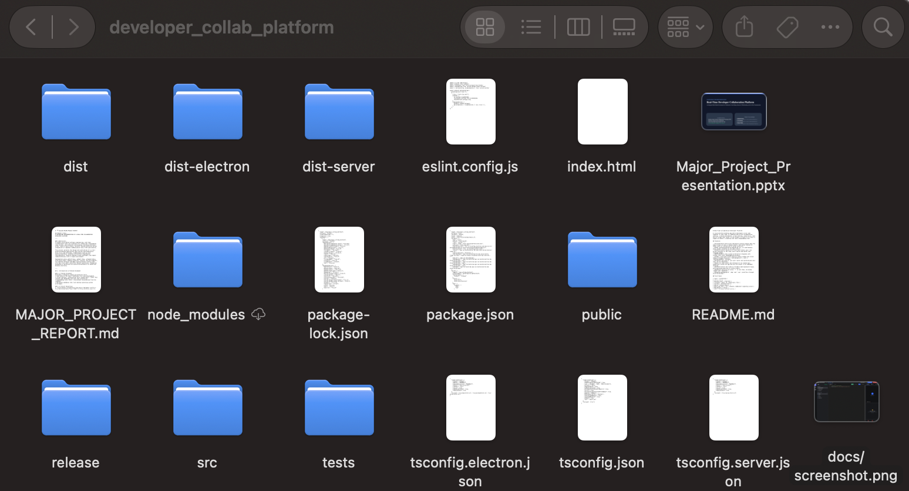
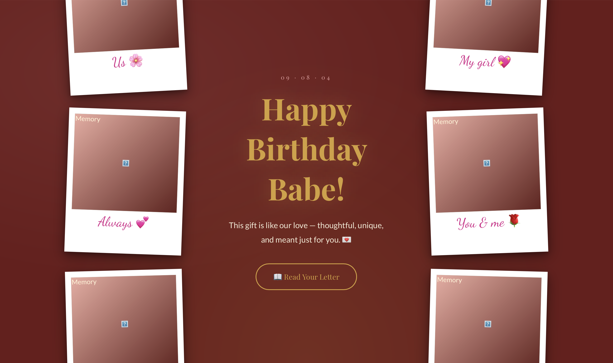
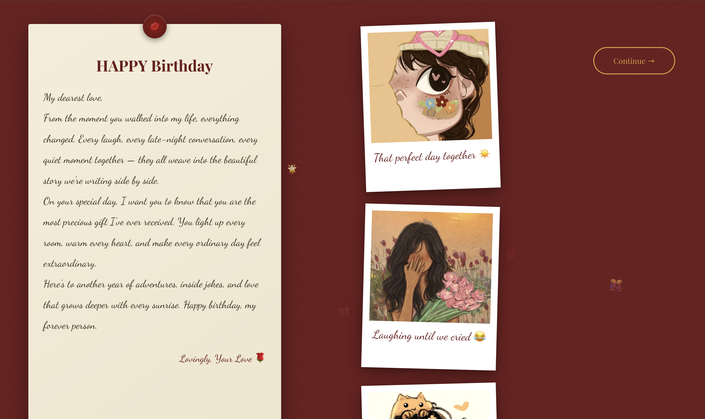
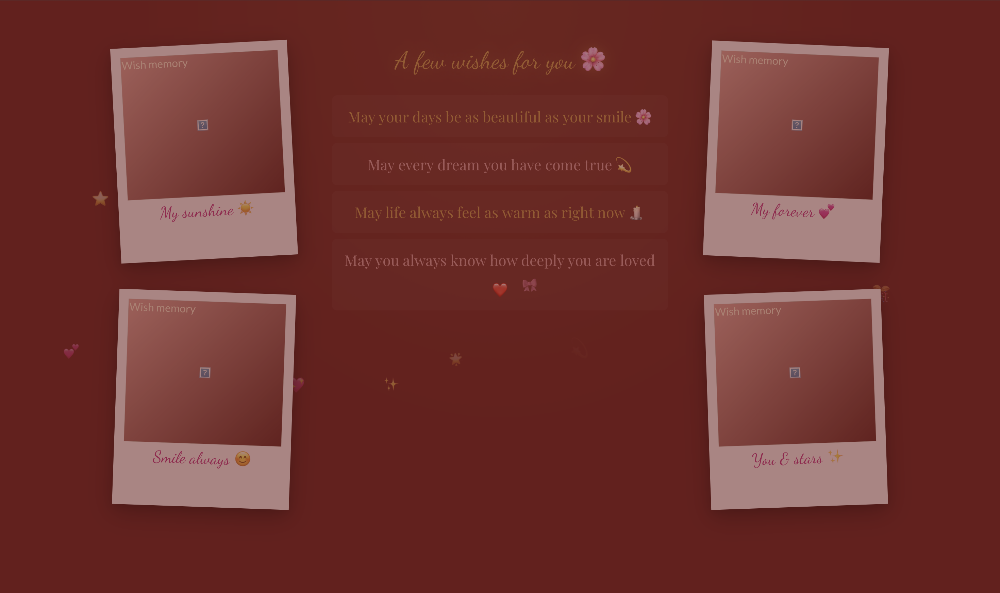
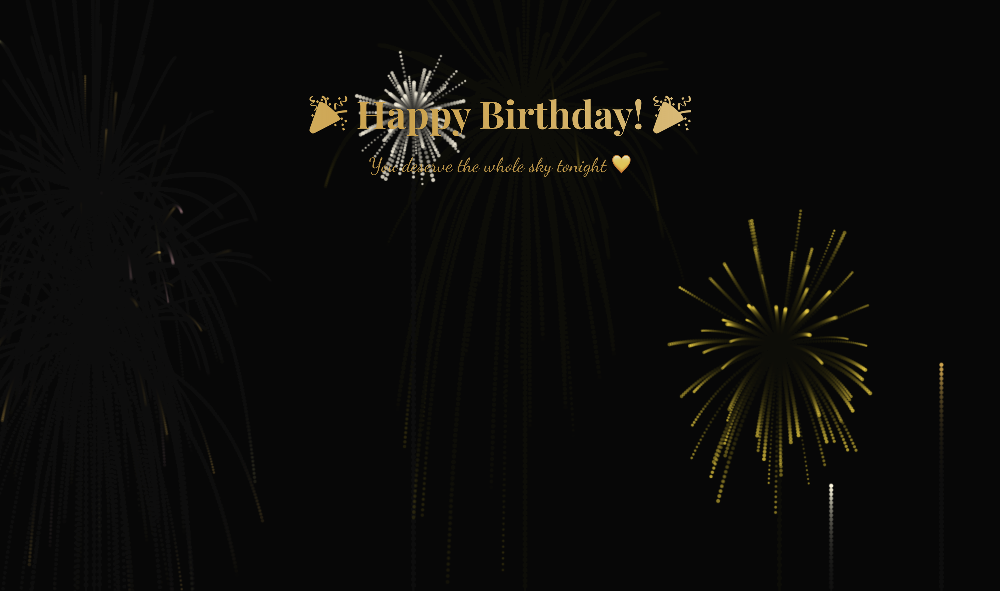

# Birthday Wishing Site

A demo birthday wishing website built with HTML, CSS and JavaScript, with a photo gallery and background music.

## Screenshots

## Tech Stack

- HTML, CSS, JavaScript

## Run Locally

Clone the repo and open `index.html` in your browser. No installation or build step is needed.

## Customize

Replace the `placeholder` images with your own photos and swap `your-music1.mp3` for your own song. Edit the names and message text in `index.html`.

## Author

**Shailendar Rawat**
GitHub: [@ShailendarRawat](https://github.com/ShailendarRawat)
